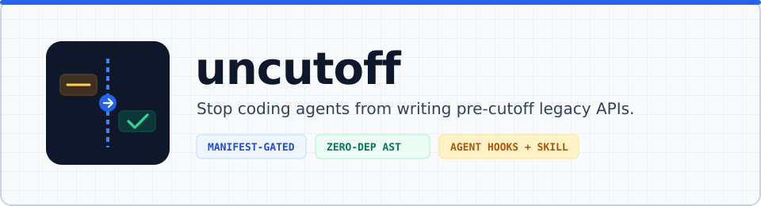

<p align="center">
  
</p>

<h1 align="center">uncutoff</h1>

<p align="center">
  Stop coding agents from writing pre-cutoff legacy APIs.
</p>

<p align="center">
  <a href="https://github.com/SuzumiyaHaruhi719/uncutoff/actions/workflows/ci.yml"></a>
  <a href="https://github.com/SuzumiyaHaruhi719/uncutoff/releases/latest"></a>
  <a href="https://github.com/SuzumiyaHaruhi719/uncutoff/blob/main/LICENSE"></a>
  
  
</p>

<p align="center">
  <a href="#quickstart">Quickstart</a> ·
  <a href="#before-and-after">Before &amp; After</a> ·
  <a href="#install-for-your-agent">Agent Install</a> ·
  <a href="#rule-packs">Rule Packs</a> ·
  <a href="https://suzumiyaharuhi719.github.io/uncutoff/">Rule Catalog</a>
</p>

---

<p align="center">
  
</p>

`uncutoff` pairs a version-gated AST and config scanner with an open Agent Skill (`SKILL.md`) and native lifecycle hooks for **Claude Code**, **OpenAI Codex CLI**, **Google Gemini CLI**, **Cursor**, and **Google Antigravity**. It reads your project's `pyproject.toml` and `package.json` first, flags deprecated or removed APIs in milliseconds with zero token cost when clean, and hands your agent the exact modern replacement when a cutoff trap slips through.

## Why

Coding agents default to high-frequency patterns from pre-cutoff training data. Even when your repository pins Pydantic v2, Python 3.12, Tailwind CSS v4, Next.js 15, Svelte 5, or `google-genai`, agents still emit `@validator`, `.dict()`, `datetime.utcnow()`, `import google.generativeai`, `@tailwind base`, `tailwind.config.js`, and synchronous `cookies()`.

- **Pull-based docs MCPs miss confident mistakes.** Agents only fetch external documentation when they doubt their memory; pre-cutoff APIs feel familiar, so they never trigger a lookup.
- **Unscoped `CLAUDE.md` rules drift and waste tokens.** Long prose lists degrade in long sessions and trigger false positives on older repositories that intentionally stay on Pydantic v1 or Tailwind v3.
- **`uncutoff` gates every check on your actual manifests.** A repository on Tailwind v3 gets zero Tailwind v4 warnings. A repository on Tailwind v4 gets instant deterministic feedback the moment an agent writes `@tailwind utilities`.

## Features

- **Manifest-aware version gating**: Automatically detects installed and declared versions from `pyproject.toml`, `uv.lock`, `requirements.txt`, `package.json`, `pnpm-lock.yaml`, and `package-lock.json`.
- **Zero-dependency Python AST & structural scanner**: Uses `ast.parse` for Python so docstrings, comments, and log strings never trigger false positives. Runs on standard library Python 3.10+ in under 30ms.
- **21 high-signal cutoff rules (`CUT-001` to `CUT-090`)**: Covers Python 3.10+/3.12+, Pydantic v2, FastAPI lifespan, SQLAlchemy 2.0, AI SDKs (`google-genai`, OpenAI v1+, retired model IDs), Tailwind v4, Next.js 15+ async request APIs, React 19, Svelte 5 runes, Zod v4, and ESLint v9 flat config.
- **Native self-correction hooks**: One-command installer wires `PostToolUse` / `BeforeTool` / `PreToolUse` hooks for Claude Code, Codex CLI, Gemini CLI, and Antigravity.
- **CI and editor output formats**: Emits terminal reports, structured JSON, or SARIF 2.1.0 for GitHub Code Scanning, plus `--diff` and `--staged` modes for pull requests.

## Before and After

Three verified tasks from [`examples/before-after/`](examples/before-after/) run with and without `uncutoff`:

<table>
<tr>
<th>Without <code>uncutoff</code> (Pre-Cutoff Drift)</th>
<th>With <code>uncutoff</code> (Manifest-Gated Fix)</th>
</tr>
<tr>
<td>

**1. Python 3.12 + Pydantic v2 + Gemini API service**
```python
from datetime import datetime
from typing import Optional
import google.generativeai as genai
from pydantic import BaseModel, validator

class Item(BaseModel):
    tag: Optional[str] = None
    created: datetime = datetime.utcnow()

    class Config:
        orm_mode = True

    @validator("tag")
    def clean(cls, v):
        return v.strip() if v else v

payload = item.dict()
```
`uncutoff scan` catches **6** traps (`CUT-001`, `CUT-003`, `CUT-010`, `CUT-011`, `CUT-012`, `CUT-030`).

</td>
<td>

```python
from datetime import UTC, datetime
from google import genai
from pydantic import BaseModel, ConfigDict, field_validator

class Item(BaseModel):
    model_config = ConfigDict(from_attributes=True)
    tag: str | None = None
    created: datetime = datetime.now(UTC)

    @field_validator("tag")
    @classmethod
    def clean(cls, v: str | None) -> str | None:
        return v.strip() if v else v

payload = item.model_dump()
client = genai.Client()
```
`uncutoff scan` exits `0` (`0 issues`).

</td>
</tr>
<tr>
<td>

**2. Tailwind CSS v4 + Next.js 15 route/component**
```css
/* app/globals.css with tailwindcss ^4.0.0 */
@tailwind base;
@tailwind components;
@tailwind utilities;
```
```ts
import { cookies } from "next/headers";

export function readTheme() {
  return cookies().get("theme")?.value;
}
```
`uncutoff scan` catches both cutoff traps (`CUT-040` × 3 directives, `CUT-050`) that fail or silently drop styling in v4 / Next 15+.

</td>
<td>

```css
/* app/globals.css */
@import "tailwindcss";
```
```ts
import { cookies } from "next/headers";

export async function readTheme() {
  const cookieStore = await cookies();
  return cookieStore.get("theme")?.value;
}
```
`uncutoff scan` exits `0` (`0 issues`).

</td>
</tr>
<tr>
<td>

**3. Legacy Repo Negative Check (`tailwindcss ^3.4`, `pydantic ^1.10`)**
```css
@tailwind base;
@tailwind components;
@tailwind utilities;
```
```python
from pydantic import BaseModel, validator
```
A naive regex linter fires false positives everywhere.

</td>
<td>

```text
$ uncutoff detect examples/before-after/legacy-pin
  tailwindcss=3.4.0  pydantic=1.10.18
$ uncutoff scan examples/before-after/legacy-pin
  0 issues (0 packs triggered false positives)
```
Version gates keep legacy-pinned codebases quiet.

</td>
</tr>
</table>

## Quickstart

1. Install `uncutoff`:

```bash
pip install git+https://github.com/SuzumiyaHaruhi719/uncutoff.git
# or add directly as an Agent Skill across Claude Code, Codex, Cursor, Gemini CLI, and Antigravity:
npx skills add SuzumiyaHaruhi719/uncutoff
```

2. Inspect detected versions and scan your repository:

```bash
uncutoff detect .
uncutoff scan .
```

3. Enable automatic self-correction hooks for your coding agent:

```bash
uncutoff hook install --agent claude
```

## Install for Your Agent

### Universal Agent Skills CLI (`npx skills add`)

Works with Claude Code, Codex CLI, Gemini CLI, Cursor, and Antigravity:

```bash
npx skills add SuzumiyaHaruhi719/uncutoff
```

You can also run the bundled zero-dependency script directly without installing a Python package:

```bash
python3 .claude/skills/uncutoff/scripts/uncutoff_cli.py scan .
```

### Claude Code

Install as a Claude Code plugin:

```bash
claude plugin marketplace add SuzumiyaHaruhi719/uncutoff
claude plugin install uncutoff@uncutoff
```

Or copy the skill directory into `.claude/skills/uncutoff/` (project) or `~/.claude/skills/uncutoff/` (global), and wire the `PostToolUse` hook into `.claude/settings.json`:

```bash
uncutoff hook install --agent claude
```

### OpenAI Codex CLI

Copy `skills/uncutoff/` into `.agents/skills/uncutoff/` (project) or `~/.codex/skills/uncutoff/` (global), and install the Codex hook in `.codex/hooks.json`:

```bash
uncutoff hook install --agent codex
```

### Google Gemini CLI

Install the extension or copy `skills/uncutoff/` into `.agents/skills/uncutoff/` (project) or `~/.gemini/skills/uncutoff/` (global), and add the `BeforeTool` hook to `.gemini/settings.json`:

```bash
uncutoff hook install --agent gemini
```

### Cursor

Copy `skills/uncutoff/` into `.cursor/skills/uncutoff/` (project) or `~/.cursor/skills/uncutoff/` (global), or point Cursor to `.cursor-plugin/plugin.json`.

### Google Antigravity

Copy `skills/uncutoff/` into `.agents/skills/uncutoff/` (project) or `~/.gemini/config/skills/uncutoff/` (global), and wire `.agents/hooks.json`:

```bash
uncutoff hook install --agent antigravity
```

### Claude Desktop / Web

Download `uncutoff-skill.zip` from the [latest GitHub Release](https://github.com/SuzumiyaHaruhi719/uncutoff/releases/latest) and upload it under **Settings -> Capabilities -> Skills**.

## Usage Examples

```bash
# Detect manifest versions and active rule packs
uncutoff detect --format json

# Scan only files changed in git (working tree or staged)
uncutoff scan --diff
uncutoff scan --staged

# Override version gates and run every rule pack
uncutoff scan --all-packs src/

# Suppress or select specific rules
uncutoff scan --ignore CUT-003,CUT-090 .
uncutoff scan --select CUT-010,CUT-030 .

# Emit SARIF 2.1.0 for GitHub Code Scanning
uncutoff scan --format sarif . > uncutoff.sarif

# List all built-in rules and version gates
uncutoff rules
```

Inline suppressions for intentional exceptions:
- Python: `# uncutoff: ignore` or `# uncutoff: ignore[CUT-001]`
- JS/TS/CSS: `// uncutoff-ignore` or `/* uncutoff-ignore[CUT-040] */`
- Svelte/HTML: `<!-- uncutoff-ignore -->`

## Rule Packs

| Pack | Trigger Condition | Rules | What It Catches |
|---|---|---|---:|
| `python-modern` | Python `>=3.10` / `>=3.12` | `CUT-001`–`CUT-005` | `datetime.utcnow()`, `get_event_loop()`, `typing.List/Optional`, `pkg_resources`, deprecated `pyproject.toml` license table |
| `pydantic-v2` | `pydantic >=2` | `CUT-010`–`CUT-013` | `.dict()` / `.parse_obj()` / `.from_orm()`, `@validator` / `@root_validator`, `class Config:`, `Field(regex=...)` |
| `fastapi-sqlalchemy` | `fastapi`, `sqlalchemy >=2` | `CUT-020`–`CUT-021` | `@app.on_event("startup"\|"shutdown")`, `sqlalchemy.ext.declarative.declarative_base` |
| `ai-sdks` | Always active on match | `CUT-030`–`CUT-032` | EOL `google-generativeai`, removed `openai.ChatCompletion.create`, retired model IDs (`claude-3-*`, `claude-sonnet-4-20250514`, `gpt-3.5-turbo`, `gemini-1.5-*`) |
| `tailwind-v4` | `tailwindcss >=4` | `CUT-040`–`CUT-041` | `@tailwind base/components/utilities`, `tailwind.config.*` without `@config` |
| `nextjs-15` | `next >=15` | `CUT-050` | Synchronous `cookies()`, `headers()`, `draftMode()` without `await` |
| `react-19` | `react >=19` | `CUT-060` | `useFormState` imported from `react-dom` instead of `useActionState` from `react` |
| `svelte-5` | `svelte >=5` | `CUT-070` | Legacy `export let`, `$:`, `createEventDispatcher` in Svelte 5 components |
| `zod-v4` | `zod >=4` | `CUT-080` | `z.nativeEnum()`, `invalid_type_error` / `required_error` options |
| `eslint-v9` | `eslint >=9` | `CUT-090` | Legacy `.eslintrc*` / `.eslintignore` instead of `eslint.config.*` |

Browse the full interactive reference at [suzumiyaharuhi719.github.io/uncutoff](https://suzumiyaharuhi719.github.io/uncutoff/).

## Comparison with Alternatives

| Capability | `uncutoff` | Context7 MCP | `modern-web-guidance` | `trailofbits/modern-python` | Standard Linters (`ruff`, `eslint`) |
|---|---|---|---|---|---|
| Manifest version gating | Yes (`pyproject.toml` / `package.json`) | Manual query | Assumes latest browser Baseline | Fixed Python 3.11+ | Manual plugin config per repo |
| Scope | Python, Pydantic, FastAPI, AI SDKs, Tailwind v4, Next 15, React 19, Svelte 5, Zod 4 | General library docs | Browser Web APIs / CSS / HTML | `uv` / `ruff` / `ty` setup | Language syntax / style |
| Trigger mechanism | Push hook (`PostToolUse` / `BeforeTool`) + Skill | Pull tool call (skipped if model is overconfident) | Skill + browser `legacy-scan` | Text Skill | Manual CLI / CI |
| Runtime cost when clean | `<30ms`, 0 extra tokens | Network fetch + doc context tokens | Reads Markdown guides | Prompt tokens | Local CLI |

## FAQ

**Does `uncutoff` call any external network or LLM APIs?**
No. Everything runs locally using the Python standard library and works offline.

**Will it complain about intentional legacy code in older projects?**
No. Framework packs such as `tailwind-v4`, `pydantic-v2`, `nextjs-15`, `react-19`, `svelte-5`, `zod-v4`, and `eslint-v9` stay inactive unless your project's manifest declares that major version (or you explicitly pass `--all-packs`).

**Can I run it as a standalone skill without `pip install`?**
Yes. `skills/uncutoff/scripts/uncutoff_cli.py` is self-contained and has zero third-party dependencies.

**How do I exit `0` vs `1` in hooks?**
- `uncutoff scan` exits `1` when issues are found so CI fails cleanly.
- `uncutoff hook run --agent claude|gemini|antigravity` exits `0` with structured JSON decision payloads (`PostToolUse` `additionalContext` / `BeforeTool` `deny`) so the agent reads the exact fix and edits the file right away. For Codex CLI `PreToolUse`, it writes guidance to `stderr` and exits `2` to block the call.

## Roadmap

- [ ] Drizzle ORM and Prisma v6 version-gated rules ([#1](https://github.com/SuzumiyaHaruhi719/uncutoff/issues/1))
- [ ] Vue 3.5 `useTemplateRef` and reactive props destructure pack ([#2](https://github.com/SuzumiyaHaruhi719/uncutoff/issues/2))
- [ ] Astro v5 Content Layer API migration pack ([#3](https://github.com/SuzumiyaHaruhi719/uncutoff/issues/3))
- [ ] Native `.pre-commit-hooks.yaml` entrypoint for `pre-commit` and `prek` ([#4](https://github.com/SuzumiyaHaruhi719/uncutoff/issues/4))

## Contributing

Contributions are welcome! See [CONTRIBUTING.md](CONTRIBUTING.md) for local test setup, rule authoring conventions, and pull request guidelines.

## Security

Please report security issues privately through GitHub Private Vulnerability Reporting. See [SECURITY.md](SECURITY.md) for details.

## License

MIT — see [LICENSE](LICENSE).
